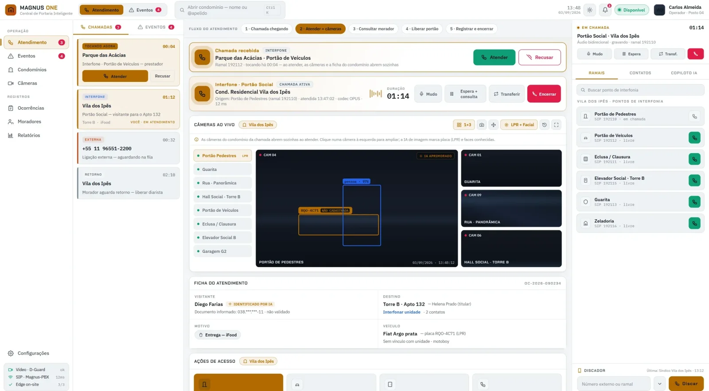
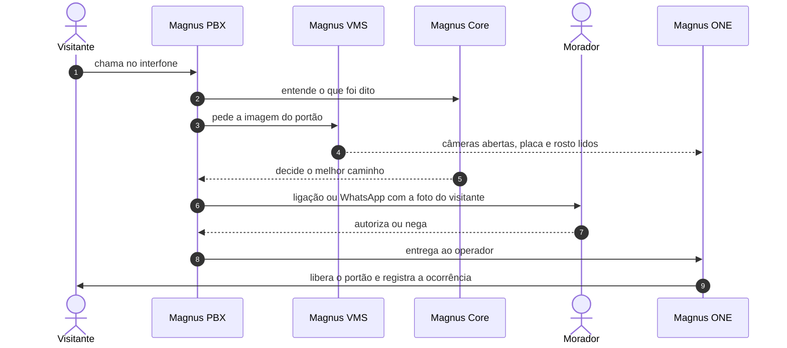
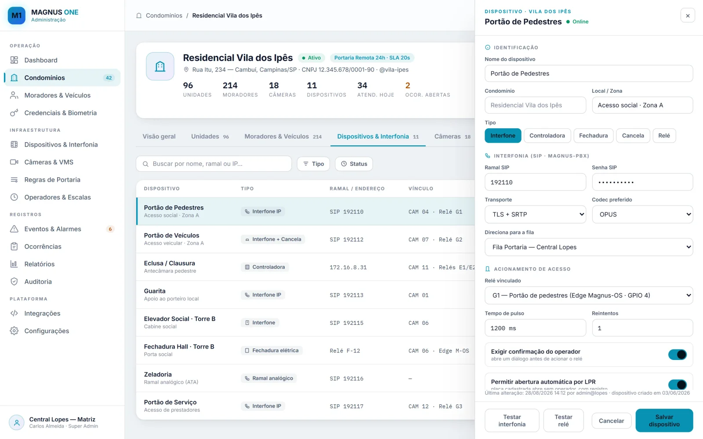
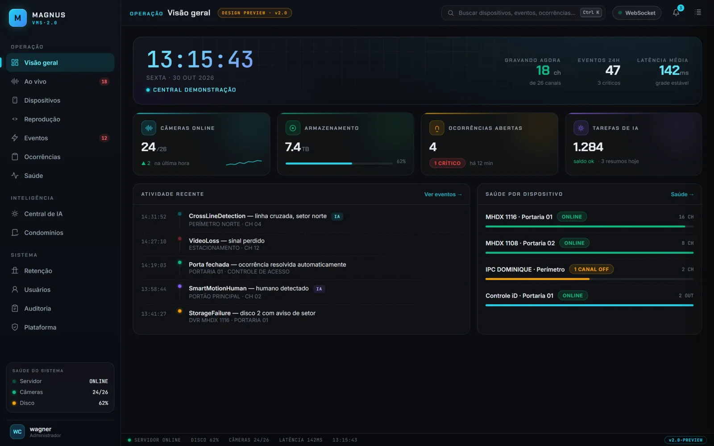
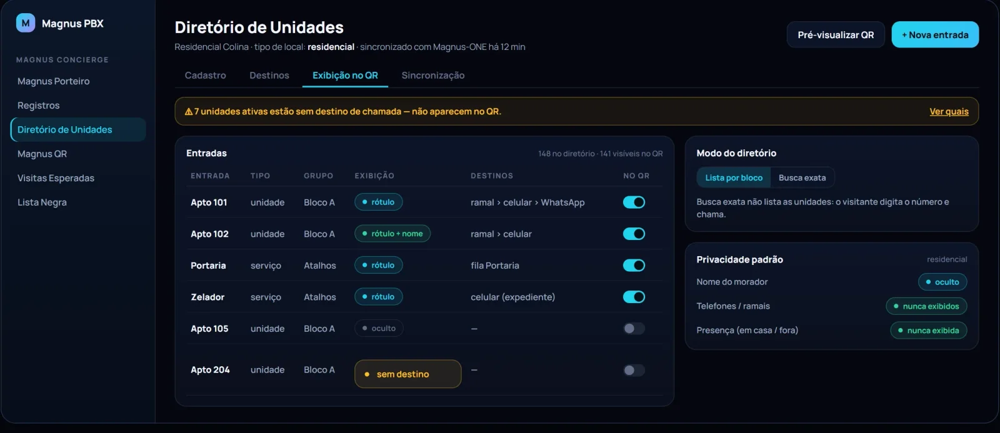
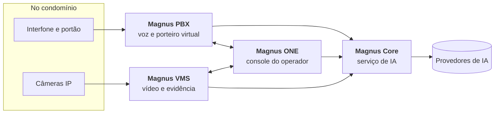

<picture>
  <source media="(prefers-color-scheme: dark)" srcset="assets/brand/logo-horizontal-escuro.svg">
  
</picture>

### Portaria remota inteligente

**Voz, vídeo e inteligência artificial trabalhando juntos na entrada de condomínios, empresas e clínicas.**

[Site](https://magnussystem.com.br) · [Como funciona](#como-funciona) · [Os sistemas](#os-quatro-sistemas) · [Avaliação técnica](docs/avaliacao-tecnica.md) · [Contato](#contato)

 

Console do operador no Magnus ONE. Tela ilustrativa, com dados fictícios.

---

## O que é

O **Magnus System** é um ecossistema de quatro sistemas que operam a portaria de um condomínio, de uma empresa ou de uma clínica **com ou sem porteiro no local**.

Quando alguém chega, o interfone é atendido por um porteiro virtual que conversa em português, as câmeras abrem sozinhas, a IA entende quem é o visitante e o morador autoriza no próprio celular, sem instalar aplicativo. Um operador humano acompanha tudo e pode assumir a qualquer momento. Cada passo fica registrado, com evidência em vídeo.

Em vez de juntar produtos de terceiros, cada peça foi construída para trabalhar com as outras. Por isso a mesma equipe responde da implantação ao suporte.

## Como funciona

## Os quatro sistemas

| | Sistema | Papel | Em uma frase |
| :-: | --- | --- | --- |
| 🟠 | [**Magnus ONE**](docs/magnus-one.md) | Operação | O console onde o operador atende, enxerga, consulta o morador e libera o acesso. |
| 🔵 | [**Magnus PBX**](docs/magnus-pbx.md) | Voz | Telefonia corporativa com porteiro virtual, call center e alta disponibilidade. |
| 🟢 | [**Magnus VMS**](docs/magnus-vms.md) | Vídeo | Gestão de câmeras que transforma gravação em evidência. |
| 🔷 | [**Magnus Core**](docs/magnus-core.md) | Inteligência | A camada de IA compartilhada: escolhe o modelo certo para cada tarefa e controla o custo. |

<table>
  <tr>
    <td width="50%"> <b>Magnus ONE</b> · administração por condomínio</td>
    <td width="50%"> <b>Magnus VMS</b> · visão geral da operação</td>
  </tr>
  <tr>
    <td colspan="2"> <b>Magnus PBX</b> · diretório de unidades e exibição para o visitante</td>
  </tr>
</table>

Cada sistema pode ser avaliado separadamente, mas o conjunto foi desenhado para integração gradual. Veja o [mapa do ecossistema](docs/ecossistema.md).

## Arquitetura em um olhar

O Core isola os provedores de IA: os demais sistemas só fazem pedidos, e as chaves de acesso nunca saem dele.

## Por que é diferente

| | |
| --- | --- |
| **Seus dados continuam seus** | Gravações, fotos e registros ficam sob controle de quem opera, com retenção configurável por cliente. |
| **Cada cliente isolado** | Um mesmo sistema atende muitos clientes sem que um enxergue o outro. |
| **Não para quando um nó falha** | Alta disponibilidade com dois nós no PBX: se um cai, o reserva assume em cerca de 15 segundos. |
| **Segurança ativa** | Bloqueio automático de tentativas, bloqueio geográfico, monitor de ataques e log de auditoria. |
| **Evidência que se sustenta** | Vídeo gravado com hash de integridade e exportação idêntica ao original. |
| **IA com custo visível** | O consumo de cada tarefa de IA é medido por cliente. |
| **Humano no controle** | A IA sugere e organiza; o operador pode assumir e toda decisão fica registrada. |

Detalhes em [segurança e privacidade](docs/seguranca-e-privacidade.md).

## Onde se aplica

- **Condomínios residenciais:** entregas, visitas e prestadores atendidos a qualquer hora, com o morador decidindo pelo celular.
- **Empresas:** recepção com atendimento por setor e pessoa, horários e regras por andar.
- **Clínicas:** categorias de atendimento e chamada ligada à agenda, sem expor nomes de pacientes na entrada.

## Base técnica

| Camada | Tecnologias |
| --- | --- |
| Telefonia | Asterisk 22 LTS, dialplan modular |
| Dados | PostgreSQL |
| Serviços | .NET 10, Rust (núcleo do VMS) |
| Interfaces | Vue 3 (consoles web), Flutter (aplicação desktop do VMS) |
| Vídeo | ONVIF (G, S e T) e drivers por fabricante, incluindo Intelbras |
| Tempo real | Atualizações em tempo real nos consoles |

## No roteiro

Em desenvolvimento, ainda não disponíveis:

- **Magnus QR:** o visitante escaneia o QR da unidade e liga pelo navegador, sem instalar app.
- **App do morador (PWA)** e **agente local** instalado no condomínio, com failover local.

## Como avaliar

1. Descreva o cenário: unidades, dispositivos, portaria atual e integrações necessárias.
2. Veja uma demonstração conduzida por um fluxo real de trabalho.
3. Registre requisitos e pontos que pedem prova de conceito.
4. Se preciso, siga para uma análise técnica sob acordo de confidencialidade.

Roteiro completo em [docs/avaliacao-tecnica.md](docs/avaliacao-tecnica.md) · Perguntas comuns em [docs/faq.md](docs/faq.md).

## Contato

| | |
| --- | --- |
| Site | [magnussystem.com.br](https://magnussystem.com.br) |
| E-mail | [contato@magnussystem.com.br](mailto:contato@magnussystem.com.br) |
| WhatsApp | [(19) 99324-0089](https://wa.me/5519993240089) |

## Quem está por trás

O Magnus System é desenvolvido e operado pela **WM Soluções em TI** (W. M. Bomfim, CNPJ 28.763.641/0001-17), empresa de tecnologia da informação de Campinas, SP, em atividade desde 2017.

## Sobre este repositório

Este repositório reúne material de apresentação dos sistemas Magnus para conversas comerciais e avaliações técnicas iniciais. **Não contém** código-fonte, imagens de produção, arquivos de infraestrutura, dados operacionais, chaves, senhas ou documentação de instalação. As telas são ilustrativas e usam dados fictícios.

Direitos e uso: [NOTICE.md](NOTICE.md).
