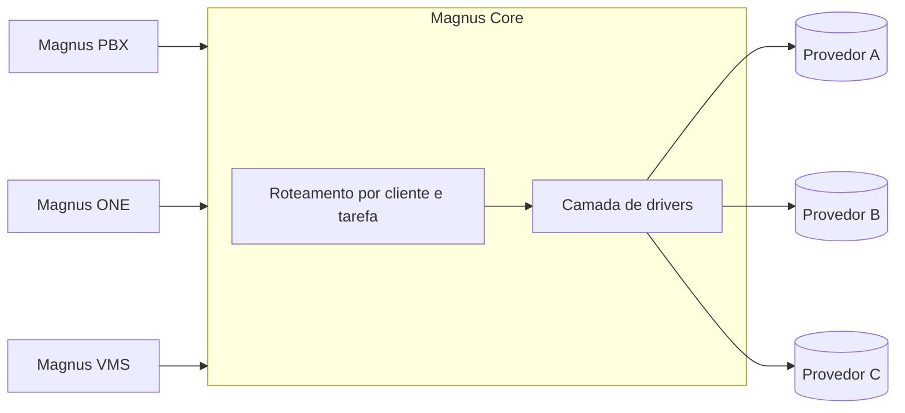

# Magnus Core

O Magnus Core é a camada de inteligência compartilhada do ecossistema. Um serviço central decide qual modelo usar para cada cliente e cada tarefa, executa a chamada e controla o custo. Os outros sistemas só pedem.

## O que entrega

| Capacidade | Descrição |
| --- | --- |
| **Roteamento por cliente e tarefa** | Cada combinação de cliente e tipo de tarefa tem seu modelo, provedor e credencial. Trocar um modelo é configuração, não código. |
| **Agente com ferramentas** | O modelo pede uma função, o Core executa e devolve o resultado, com lista de ferramentas permitidas por cliente. |
| **Decisão em tempo real** | Decisões estruturadas com probabilidades, pensadas para o tempo de uma ligação, com caminho alternativo se o principal falhar. |
| **Voz** | Síntese e reconhecimento de fala em tempo real, transcrição de gravações e catálogo de vozes. |
| **Prompts versionados** | Modelos de instrução com versão e variáveis, para mudar o comportamento da IA com rastreabilidade. |
| **Custo e segurança** | Cada produto se identifica por chave e só age nos clientes permitidos. O consumo é medido por tarefa e por cliente. |

## Papel na plataforma

- Identifica o contexto da organização e do serviço solicitado.
- Encaminha chamadas a provedores por uma camada de drivers.
- Permite evoluir os provedores sem espalhar integrações pela plataforma, sem dependência de um único fornecedor.
- Dá base para voz, texto e automação assistida nos produtos que precisam deles.

## Critérios de avaliação

Isolamento por organização, rastreabilidade das solicitações, integração com os sistemas Magnus e opções de provedores compatíveis com a política de cada operação.

## O que não é publicado aqui

Parâmetros de provedores, chaves de acesso, políticas específicas de cada cliente, dados processados e detalhes de implantação.
