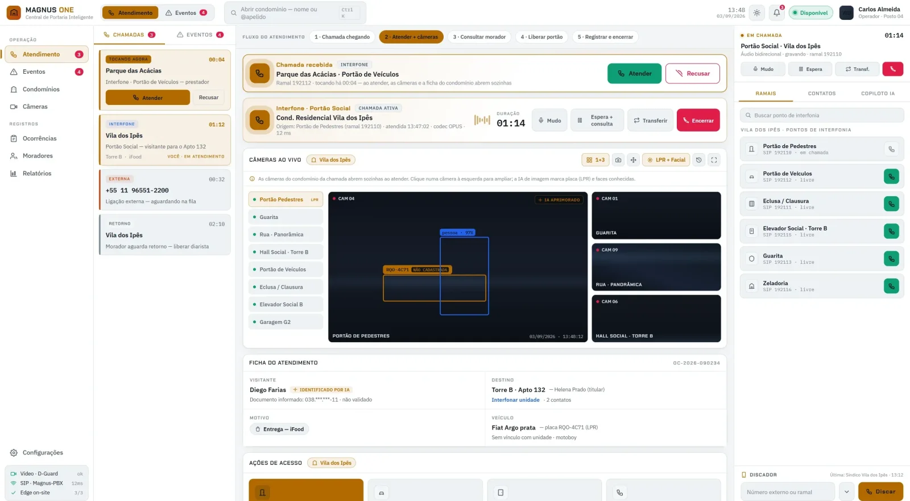
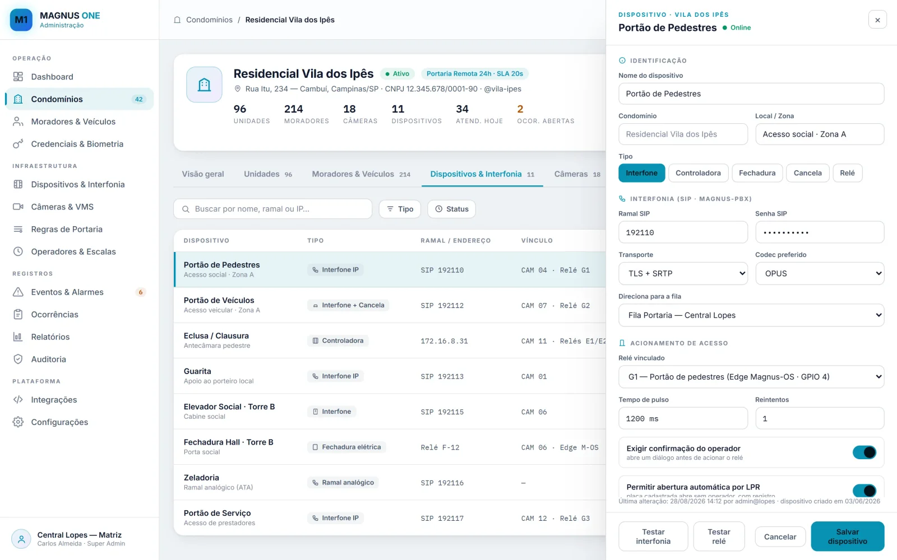

# Magnus ONE

Tela ilustrativa, com dados fictícios.

O Magnus ONE é o console onde o operador atende, enxerga, consulta o morador e libera o acesso, de qualquer lugar e para vários condomínios ao mesmo tempo. É a central da portaria inteligente.

## Papel na plataforma

- Recebe a chamada entregue pelo [Magnus PBX](magnus-pbx.md) e a voz do porteiro.
- Abre as câmeras do [Magnus VMS](magnus-vms.md) referentes àquele atendimento.
- Usa o [Magnus Core](magnus-core.md) para sugerir caminhos e redigir o registro.

## O que entrega

| Capacidade | Descrição |
| --- | --- |
| **Atendimento em um fluxo** | Chamada chegando, atender, consultar o morador, liberar o portão e registrar, tudo na mesma tela. |
| **Câmeras que abrem sozinhas** | Ao atender, as câmeras do condomínio daquela chamada aparecem na hora, com placa (LPR) e rostos conhecidos marcados pela IA. |
| **Ficha do atendimento** | Quem é o visitante, para qual unidade vai, motivo e veículo, preenchidos enquanto a conversa acontece. |
| **Ações de acesso** | Portão de pedestres, de veículos, eclusa e elevador acionados por botão, com confirmação quando a regra exige. |
| **Copiloto de IA** | Sugestões durante a chamada e rascunho da observação no encerramento. O operador revisa, edita e confirma. |
| **Administração multi-condomínio** | Condomínios, unidades, moradores, veículos, credenciais, regras de portaria, escalas, relatórios e auditoria. |

Painel de administração: dispositivos, interfonia e acionamentos por condomínio. Tela ilustrativa.

## Pontos de avaliação

Quantos condomínios cada operador atende, como são as regras de liberação, quais acionamentos existem (portão, eclusa, elevador), integrações com cadastro de moradores e política de auditoria.

## No roteiro

App do morador (PWA) e agente de borda instalado no condomínio, com failover local. Ainda não disponíveis.

## O que não é publicado aqui

Código-fonte, dados de condomínios, moradores ou veículos, credenciais e detalhes de implantação.
