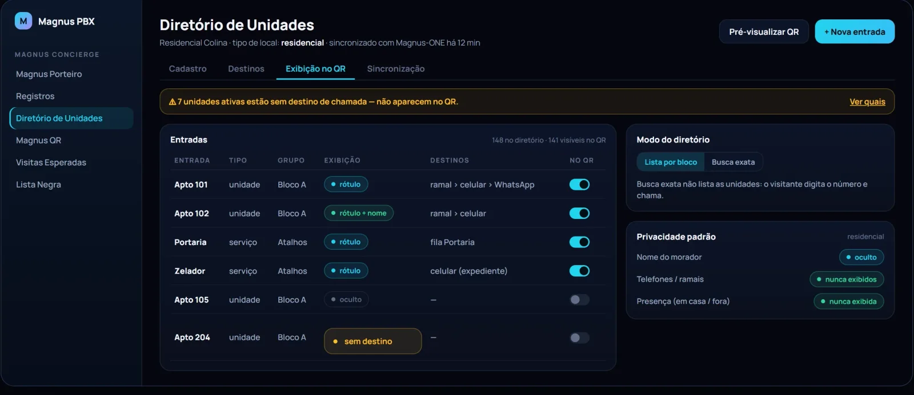
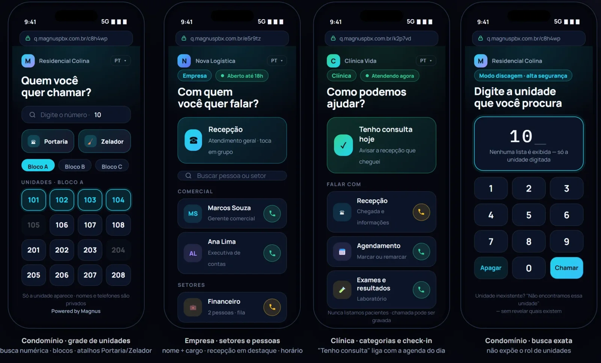

# Magnus PBX

Diretório de unidades e exibição para o visitante. Tela ilustrativa, com dados fictícios.

O Magnus PBX é uma plataforma multi-tenant de comunicação e portaria virtual, sobre Asterisk 22 LTS. Foi concebido para centralizar a operação de voz, organizar fluxos de atendimento e permitir que cada operação mantenha suas próprias regras e contexto.

## O que entrega

| Capacidade | Descrição |
| --- | --- |
| **Magnus Porteiro** | A IA atende o interfone em português, pergunta com quem o visitante quer falar, aguarda o "alô" do morador de verdade e o chama pelo nome. |
| **Autorização por WhatsApp** | A foto do visitante, tirada na hora, vai ao morador com um link para autorizar ou negar. Sem digitar nada. |
| **Portaria direta e abertura remota** | O porteiro disca um número, a IA resolve a unidade e transfere. O portão abre por tecla na ligação ou por botão na tela. |
| **PABX completo** | Ramais, troncos, rotas, URA, grupos de toque, horários e feriados brasileiros, classe de serviço e relatório de chamadas. |
| **Call center** | Filas ao vivo, CRM, dialer de campanhas, gravações com transcrição e resumo por IA, e callback para quem desistiu na fila. |
| **Magnus Shield** | Bloqueio automático de tentativas, bloqueio geográfico, monitor de ataques, listas de bloqueio e log de auditoria. |
| **Alta disponibilidade** | Dois nós com troca automática: o reserva assume em cerca de 15 segundos. |

## Base técnica

- Asterisk 22 para a camada de telefonia.
- PostgreSQL para os dados operacionais.
- Serviços em .NET 10 e console web em Vue 3.
- Atualizações em tempo real e dialplan modular.

## Dentro do ecossistema

Entrega a chamada ao [Magnus ONE](magnus-one.md), usa o [Magnus Core](magnus-core.md) para entender e decidir e traz a foto do portão do [Magnus VMS](magnus-vms.md).

## No roteiro

**Magnus QR:** o visitante escaneia o QR da unidade e liga pelo navegador, sem instalar app. Em desenvolvimento.

Proposta atual de telas do Magnus QR no celular do visitante. Ainda não disponível.

## Pontos de avaliação

Em uma demonstração, o foco pode ser colocado no cadastro de uma operação, no fluxo de chamada, na configuração de regras e na visão administrativa. A análise de integrações, telefonia e infraestrutura é tratada em ambiente controlado, conforme o escopo da avaliação.

## O que não é publicado aqui

Código-fonte, dialplans completos, configurações de troncos, dados de assinantes, endereços de rede, topologias de clientes e qualquer credencial permanecem fora deste repositório.
