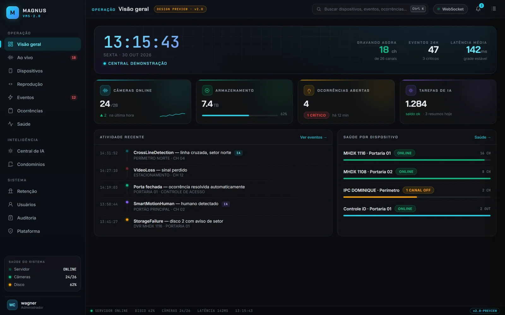

# Magnus VMS

Visão geral da operação: câmeras, armazenamento, ocorrências e atividade recente. Tela ilustrativa, com dados fictícios.

O Magnus VMS é uma plataforma de gestão de vídeo voltada a operações que precisam organizar dispositivos, visualização e gravações em um único ambiente. Gravação confiável, resposta rápida e integração aberta, para o operador que precisa decidir em segundos.

## O que entrega

| Capacidade | Descrição |
| --- | --- |
| **Ao vivo orientado a prioridade** | Alarme crítico abre a câmera e o pré-alarme sozinho. Mosaicos, vídeo wall e layouts salvos por operador. |
| **Gravação que vale como prova** | Sem recompressão, com hash de integridade e exportação idêntica ao original. Eventos protegidos contra a retenção. |
| **Ocorrências** | Atendimento, procedimento, evidências, responsável, SLA e encerramento reunidos em uma entidade de trabalho. |
| **Reprodução e busca** | Linha do tempo densa, marcadores, busca por data e evento e exportação em lote. |
| **Central de IA** | Análises como cruzamento de linha e detecção de movimento humano, desacopladas da gravação. |
| **Saúde do sistema** | Falhas de gravação, relógio, disco, latência e perda de pacotes visíveis antes de virarem problema. |

## Base técnica

- Núcleo em Rust.
- Serviços em .NET e interface web em Vue 3.
- Aplicação desktop em Flutter.
- Integração com dispositivos Intelbras e ONVIF (G, S e T).
- Organização multi-tenant e suporte a fluxos de gravação passthrough.

Clientes disponíveis: web, Windows e Android.

## Dentro do ecossistema

Abre as câmeras de cada atendimento no [Magnus ONE](magnus-one.md), fornece a imagem do portão ao porteiro do [Magnus PBX](magnus-pbx.md) e troca análises com o [Magnus Core](magnus-core.md).

## Pontos de avaliação

Uma demonstração deve partir do ambiente pretendido: quantidade e perfil das câmeras, necessidade de retenção, disponibilidade de rede, funções por equipe e integrações desejadas. Dessa forma, a análise fica ligada ao problema a ser resolvido, e não apenas a uma lista de recursos.

## O que não é publicado aqui

Inventário de dispositivos, endereços, credenciais, imagens de clientes, políticas de retenção e detalhes de rede não fazem parte deste material.
